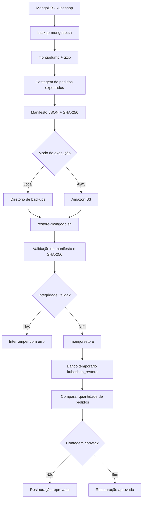
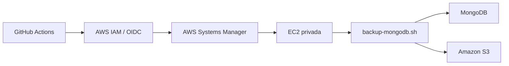

# Backup e Restauração do MongoDB

## 1. Objetivo

Este documento descreve a estratégia de backup e restauração
do banco de dados MongoDB utilizado pelo projeto KubeShop.

A solução tem como objetivos:

- Proteger os pedidos armazenados no banco de dados.
- Automatizar a geração de backups.
- Verificar a integridade dos arquivos gerados.
- Permitir a recuperação dos dados em caso de falha.
- Evitar a sobrescrita dos pedidos existentes durante testes
  de restauração.
- Preparar a rotina para integração com GitHub Actions.
- Utilizar Amazon S3 como armazenamento externo de backups.

## 2. Ambiente e tecnologias

| Componente | Tecnologia |
|---|---|
| Banco de dados | MongoDB 8.0.17 |
| Banco da aplicação | kubeshop |
| Coleção de pedidos | orders |
| Infraestrutura | Amazon EC2 |
| Sistema operacional | Ubuntu 24.04 LTS |
| Containerização | Docker e Docker Compose |
| Armazenamento persistente | Amazon EBS gp3 criptografado |
| Armazenamento de backups | Amazon S3 |
| Ferramenta de backup | mongodump |
| Ferramenta de restauração | mongorestore |
| Consulta e validação | mongosh |
| Automação | Bash |
| Manifesto e integridade | Python 3, JSON e SHA-256 |
| Pipeline prevista | GitHub Actions |
| Região AWS | us-east-1 |

O MongoDB está previsto para execução em uma instância EC2
localizada em uma sub-rede privada, sem endereço IP público.

Os dados persistentes são armazenados em um volume EBS gp3
criptografado de 20 GiB.

O armazenamento persistente em EBS não substitui uma rotina
de backup independente.

## 3. Estrutura dos arquivos

Os scripts responsáveis pela rotina estão localizados em:

- `scripts/backup/backup-mongodb.sh`
- `scripts/backup/restore-mongodb.sh`

O primeiro realiza a exportação dos dados, a geração do
manifesto e o armazenamento do backup.

O segundo verifica a integridade do arquivo e realiza a
restauração em um banco temporário.

Ambos possuem dois modos de execução:

| Modo | Finalidade |
|---|---|
| local | Testes sem dependência de serviços AWS |
| s3 | Armazenamento e recuperação pelo Amazon S3 |

O modo padrão é `s3`.

## 4. Estratégia de backup

A estratégia utiliza backups lógicos completos do banco
`kubeshop`, gerados com `mongodump`.

O arquivo é produzido no formato archive e compactado
utilizando gzip.

A quantidade de pedidos registrada no manifesto é obtida
da saída do mongodump, correspondendo à quantidade de
documentos exportados da coleção orders.

Essa abordagem evita depender exclusivamente de uma
contagem realizada antes da exportação.

Entretanto, ela não garante um snapshot transacional
consistente de todo o banco durante escritas concorrentes.

### 4.1. Política de backup proposta

| Parâmetro | Configuração proposta |
|---|---|
| Tipo | Backup lógico completo |
| Frequência | Diária |
| Horário | 03:00 UTC |
| Retenção | 30 dias |
| Compactação | gzip |
| Destino | Amazon S3 |
| Criptografia | SSE-S3 (AES-256) |
| Verificação de integridade | SHA-256 |
| Validação funcional | Restauração em banco temporário |
| RPO | Até 24 horas |
| RTO | Até 60 minutos |

A frequência, o horário e a retenção são propostas
operacionais. O agendamento e a política de ciclo de vida
ainda precisam ser configurados na infraestrutura AWS.

## 5. Fluxo de backup e restauração



O banco original não é utilizado como destino da
restauração automatizada.

## 6. Script de backup

Arquivo: [`backup-mongodb.sh`](../scripts/backup/backup-mongodb.sh)

### 6.1. Funcionamento

O script realiza as seguintes operações:

1. Verifica as dependências necessárias.
2. Identifica o modo de execução.
3. Cria um diretório temporário.
4. Executa o mongodump dentro do container MongoDB.
5. Gera um arquivo archive compactado.
6. Verifica se o arquivo não está vazio.
7. Valida a compactação gzip.
8. Identifica a quantidade de pedidos exportados.
9. Calcula o hash SHA-256.
10. Gera o manifesto JSON.
11. Armazena os arquivos localmente ou no Amazon S3.
12. Remove os arquivos temporários.
13. Retorna o resultado da operação.

O script utiliza tratamento de erros do Bash e retorna
um código de saída diferente de zero em caso de falha.

A mensagem de sucesso é:

```text
BACKUP=APROVADO
```

### 6.2. Variáveis de ambiente

| Variável | Descrição | Valor padrão |
|---|---|---|
| BACKUP_MODE | Modo de execução | s3 |
| PROJECT_DIR | Diretório da aplicação | /opt/kubeshop |
| MONGO_CONTAINER | Container alternativo para testes | Não definido |
| LOCAL_BACKUP_DIR | Diretório de destino local | Não definido |
| S3_BUCKET | Nome do bucket de backup | Não definido |
| S3_PREFIX | Prefixo dos objetos | kubeshop/mongodb |
| AWS_REGION | Região AWS | us-east-1 |

O banco de origem é definido no script como kubeshop.

Quando MONGO_CONTAINER não é informado, o script utiliza
o serviço mongodb do arquivo compose.db.yaml.

### 6.3. Dependências

Na máquina responsável pela execução:

- Bash.
- Docker.
- Docker Compose, quando utilizado o serviço do projeto.
- Python 3.
- gzip.
- AWS CLI, somente no modo S3.

As ferramentas mongodump, mongorestore e mongosh são
executadas dentro do container MongoDB.

O script identifica automaticamente os comandos python3
ou python e possui tratamento de caminhos para Git Bash.

### 6.4. Execução na AWS

A execução deverá ocorrer na EC2 do banco de dados, com
acesso ao container MongoDB e ao Amazon S3.

Exemplo de configuração:

```bash
cd /opt/kubeshop

export BACKUP_MODE=s3
export PROJECT_DIR=/opt/kubeshop
export S3_BUCKET=nome-do-bucket-de-backup
export S3_PREFIX=kubeshop/mongodb
export AWS_REGION=us-east-1

bash scripts/backup/backup-mongodb.sh
```

O nome do bucket é ilustrativo e deverá ser substituído
pelo nome do recurso efetivamente provisionado.

## 7. Manifesto JSON

Cada backup possui um manifesto associado.

O manifesto contém os metadados necessários para a
identificação e validação da restauração.

| Campo | Descrição |
|---|---|
| database | Banco de dados exportado |
| collection | Coleção utilizada na validação |
| documentCount | Quantidade de pedidos exportados |
| timestamp | Data e horário UTC do backup |
| backupFile | Nome do arquivo compactado |
| sha256 | Hash SHA-256 do arquivo |

### 7.1. Manifesto real gerado durante o teste

```json
{
  "database": "kubeshop",
  "collection": "orders",
  "documentCount": 11,
  "timestamp": "20261127T230530Z",
  "backupFile": "kubeshop_20261127T230530Z_1366.archive.gz",
  "sha256": "4d426e29961c9548a182d0ba57e33bd8536a618a1b9f2fed3d2ebd2b14153de3"
}
```

O manifesto foi gerado automaticamente pelo script durante
o teste funcional local realizado em 27/11/2026.

## 8. Verificação de integridade SHA-256

SHA-256 é uma função criptográfica de hash que produz
um resumo de 256 bits a partir do conteúdo de um arquivo.

Durante o backup, o script calcula o hash do arquivo
compactado e registra o resultado no manifesto JSON.

Antes da restauração, o script calcula novamente o hash
do arquivo recebido e compara com o valor registrado.

Caso os valores sejam diferentes, a restauração é
interrompida antes da importação dos documentos.

Essa verificação permite detectar alterações e corrupções
no arquivo de backup.

O SHA-256 não substitui a criptografia do armazenamento
e não garante autenticidade caso um agente consiga
modificar simultaneamente o backup e seu manifesto.

Por isso, o acesso ao bucket deve ser restrito por IAM.

## 9. Script de restauração

Arquivo: [`restore-mongodb.sh`](../scripts/backup/restore-mongodb.sh)

### 9.1. Funcionamento

O script realiza as seguintes operações:

1. Recebe o caminho local ou a chave S3 do backup.
2. Obtém o arquivo compactado e seu manifesto.
3. Verifica se o arquivo não está vazio.
4. Valida a compactação gzip.
5. Verifica os campos necessários do manifesto.
6. Calcula e compara o hash SHA-256.
7. Identifica a quantidade esperada de pedidos.
8. Gera um nome de banco temporário.
9. Executa o mongorestore.
10. Consulta a quantidade de pedidos restaurados.
11. Compara o resultado com o manifesto.
12. Informa a quantidade de pedidos no banco original.
13. Retorna o resultado da validação.

O nome do banco temporário segue o padrão:

```text
kubeshop_restore_<timestamp>_<pid>
```

O script não utiliza a opção --drop e não restaura
diretamente sobre o banco original.

A restauração é considerada aprovada quando a quantidade
de pedidos recuperados corresponde à quantidade
registrada no manifesto.

A mensagem de sucesso é:

```text
RESULTADO=APROVADO
```

### 9.2. Execução na AWS

```bash
cd /opt/kubeshop

export BACKUP_MODE=s3
export PROJECT_DIR=/opt/kubeshop
export S3_BUCKET=nome-do-bucket-de-backup
export AWS_REGION=us-east-1

bash scripts/backup/restore-mongodb.sh \
  kubeshop/mongodb/NOME_DO_BACKUP.archive.gz
```

O arquivo de backup e seu manifesto devem existir
no mesmo prefixo do bucket.

### 9.3. Recuperação efetiva da aplicação

A restauração automatizada tem finalidade de recuperação
isolada e validação dos dados.

Ela não promove automaticamente o banco temporário para
produção e não altera a conexão utilizada pela aplicação.

Em caso de desastre real, a recuperação deverá incluir:

1. Identificação do incidente.
2. Seleção do último backup válido.
3. Restauração em ambiente isolado.
4. Validação da integridade e dos dados recuperados.
5. Avaliação dos pedidos registrados após o backup.
6. Definição de uma estratégia de reconciliação.
7. Aprovação da equipe responsável.
8. Promoção controlada dos dados recuperados.
9. Teste funcional da aplicação.

A substituição do banco original não deverá ocorrer
automaticamente.

Bancos temporários devem ser removidos posteriormente,
mediante autorização, para evitar consumo desnecessário
de armazenamento.

## 10. RPO e RTO

### 10.1. Recovery Point Objective (RPO)

O RPO representa a quantidade máxima aceitável de dados
que pode ser perdida em um incidente.

Para o projeto, propõe-se:

**RPO: até 24 horas.**

A meta considera a execução diária de backups completos.

Caso ocorra uma falha imediatamente antes do próximo
backup, os dados registrados após o último backup válido
podem precisar ser recuperados por outros meios.

A meta depende da execução bem-sucedida dos backups.
Falhas consecutivas podem aumentar a perda potencial.

A preservação dos pedidos durante o teste de restauração
isolada não significa que o RPO seja igual a zero.

### 10.2. Recovery Time Objective (RTO)

O RTO representa o tempo máximo aceitável para recuperar
a operação após um incidente.

Para o projeto, propõe-se:

**RTO: até 60 minutos.**

O tempo deve considerar:

- Identificação da falha.
- Seleção e obtenção do backup.
- Verificação de integridade.
- Restauração dos documentos.
- Validação dos dados.
- Reconciliação de pedidos, quando necessária.
- Recuperação e teste da aplicação.

O RTO ainda não foi medido em condições reais na AWS.

Os testes locais utilizaram uma quantidade reduzida de
documentos e não representam o volume de produção.

## 11. Integração com Amazon S3

O Amazon S3 é o destino previsto para armazenamento
externo dos backups.

A estrutura proposta é:

```text
s3://nome-do-bucket-de-backup/
    kubeshop/
        mongodb/
            kubeshop_<timestamp>_<pid>.archive.gz
            kubeshop_<timestamp>_<pid>.archive.gz.manifest.json
```

### 11.1. Configuração recomendada

| Configuração | Recomendação |
|---|---|
| Região | us-east-1 |
| Classe de armazenamento | S3 Standard |
| Acesso público | Bloqueado |
| Criptografia | SSE-S3 |
| Versionamento | Habilitado |
| Retenção | 30 dias |
| Controle de acesso | IAM |
| Transporte | HTTPS |

A política de ciclo de vida deve considerar tanto os
objetos atuais quanto as versões não atuais, caso o
versionamento esteja habilitado.

O script envia os arquivos com criptografia SSE-S3 e
verifica sua existência utilizando head-object.

Essa verificação confirma a existência dos objetos,
mas não substitui um teste de recuperação pelo S3.

O bucket ainda não está provisionado pelo Terraform
analisado. Sua criação é uma dependência da integração.

### 11.2. Permissões IAM

A EC2 responsável pelo backup deverá utilizar uma IAM Role
com permissões restritas ao bucket e ao prefixo de backup.

| Permissão | Finalidade |
|---|---|
| s3:PutObject | Enviar backups e manifestos |
| s3:GetObject | Consultar metadados e baixar arquivos |
| s3:ListBucket | Listar backups, quando necessário |

A permissão s3:ListBucket deve ser limitada ao prefixo
utilizado pelo projeto.

Não é necessário conceder acesso administrativo ao S3.

A rotina não necessita de s3:DeleteObject, pois a
expiração deverá ser controlada pelo ciclo de vida.

As permissões atuais de SSM não concedem automaticamente
acesso aos objetos do bucket.

A configuração IAM deverá ser realizada pela equipe
responsável pela infraestrutura.

## 12. Segurança

As seguintes medidas foram consideradas:

- MongoDB localizado em sub-rede privada.
- Banco de dados sem endereço IP público.
- Security Group restringindo o acesso ao MongoDB.
- Volume EBS de dados criptografado.
- Autenticação obrigatória no MongoDB.
- Usuário da aplicação utilizado para o backup.
- Usuário administrativo utilizado para restauração.
- Credenciais obtidas dos secrets do Docker Compose.
- Arquivos temporários com permissões restritas.
- Remoção automática dos arquivos temporários.
- Verificação SHA-256 antes da restauração.
- Restauração em banco temporário.
- Bucket S3 privado como configuração proposta.
- Utilização de IAM Role em vez de chaves AWS fixas.

No ambiente local, o script também aceita a credencial
administrativa configurada no container isolado de teste.

Essa alternativa é destinada exclusivamente aos testes.

Credenciais reais, arquivos de secrets, dumps e manifestos
com informações operacionais não devem ser publicados
indevidamente no repositório Git.

## 13. Integração com GitHub Actions

Os scripts foram preparados para integração futura
com a pipeline do projeto.

A rotina proposta consiste em:

1. Disparar o workflow por agendamento diário.
2. Autenticar na AWS com credenciais temporárias,
   preferencialmente utilizando OIDC.
3. Executar o script na EC2 privada por AWS Systems Manager.
4. Aguardar a conclusão do comando remoto.
5. Verificar o código de saída.
6. Registrar o resultado da operação.
7. Notificar a equipe em caso de falha.



A execução pelo Systems Manager permite acessar a EC2
privada sem expor a porta SSH à internet.

A identidade utilizada pela pipeline deverá possuir
permissões específicas para enviar e consultar comandos
SSM, limitadas aos recursos autorizados.

A integração ainda depende da configuração da pipeline,
das permissões IAM e do bucket S3.

## 14. Testes funcionais realizados

### 14.1. Ambiente de teste

Os testes foram realizados em 27/11/2026.

| Componente | Ambiente utilizado |
|---|---|
| Sistema operacional | Windows |
| Terminal | PowerShell e Git Bash |
| Containerização | Docker Desktop |
| MongoDB | 8.0.17 |
| Python | 3.13.17 |
| Container | kubeshop-mongo-test |
| Banco original | kubeshop |
| Dados | Pedidos fictícios |
| Armazenamento | Diretório local |

Os testes foram realizados em um container isolado,
sem utilização de dados reais de clientes.

### 14.2. Teste manual de backup e restauração

Procedimento realizado:

1. Inicialização do MongoDB em Docker.
2. Validação da conexão com o banco.
3. Inserção de 10 pedidos fictícios.
4. Geração de backup utilizando mongodump.
5. Criação manual do manifesto JSON.
6. Verificação do hash SHA-256.
7. Inserção de um décimo primeiro pedido.
8. Restauração em banco temporário.
9. Validação dos pedidos restaurados.

Resultado observado:

```text
BANCO_ORIGINAL=kubeshop
PEDIDOS_ORIGINAIS=11
BANCO_TEMPORARIO=kubeshop_restore_20261127T230035Z
PEDIDOS_RESTAURADOS=10
PEDIDOS_ESPERADOS=10
PEDIDO_11_PRESERVADO=true
RESULTADO=APROVADO
```

O teste confirmou a recuperação dos 10 pedidos do
backup e a preservação do pedido adicional no banco
original.

### 14.3. Teste automatizado de backup

O script backup-mongodb.sh foi executado no modo local.

Durante os testes foram corrigidos problemas relacionados
à identificação do Python e à conversão de caminhos
entre Git Bash e Windows.

Após as correções, foi obtido o seguinte resultado:

```text
[2026-11-27 20:05:31] Iniciando backup de kubeshop...
done dumping kubeshop.orders (11 documents)
[2026-11-27 20:05:31] Gerando manifesto JSON...
[2026-11-27 20:05:32] BACKUP=APROVADO
```

O backup foi gerado com 11 pedidos.

O arquivo compactado e o manifesto JSON foram armazenados
no diretório local configurado.

### 14.4. Teste automatizado de restauração

Após o backup automatizado, foi inserido um décimo
segundo pedido no banco original.

O script restore-mongodb.sh foi executado utilizando
o arquivo gerado anteriormente.

Resultado observado:

```text
[2026-11-27 20:06:03] Validando pedidos restaurados...
PEDIDOS_ORIGINAIS=12
PEDIDOS_ESPERADOS=11
PEDIDOS_RESTAURADOS=11
RESULTADO=APROVADO
[2026-11-27 20:06:04] Restauracao temporaria validada.
Banco disponivel para inspecao:
kubeshop_restore_20261127T230602Z_1694
```

O banco temporário recebeu os 11 pedidos registrados
no manifesto.

O banco original permaneceu com 12 pedidos.

### 14.5. Validação integral dos documentos

Uma consulta complementar utilizando mongosh comparou
os documentos originais e restaurados.

A comparação utilizou Extended JSON e ordenação pelo
identificador dos documentos.

Também foi verificada a presença do décimo segundo
pedido no banco original e sua ausência no banco
temporário.

Resultado observado:

```text
PEDIDOS_ORIGINAIS=12
PEDIDOS_RESTAURADOS=11
DOCUMENTOS_IDENTICOS=true
PEDIDO_12_PRESERVADO=true
PEDIDO_12_AUSENTE_NO_RESTORE=true
VALIDACAO_FINAL=APROVADO
```

Os 11 documentos comparados apresentaram conteúdo
idêntico no cenário testado.

O pedido registrado após o backup foi preservado.

A comparação integral foi realizada como teste
complementar e não faz parte da validação automática
atual do script.

### 14.6. Resumo dos resultados

| Teste | Resultado |
|---|---|
| Conexão com MongoDB | Aprovado |
| Backup manual | Aprovado |
| Restauração manual | Aprovado |
| Validação SHA-256 | Aprovado |
| Sintaxe dos scripts Bash | Aprovado |
| Backup automatizado local | Aprovado |
| Manifesto JSON automático | Aprovado |
| Contagem automática dos pedidos | Aprovado |
| Restauração automatizada local | Aprovado |
| Comparação integral dos documentos | Aprovado |
| Preservação dos pedidos adicionais | Aprovado |
| Rejeição de backup propositalmente corrompido | Pendente |
| Execução na EC2 | Pendente |
| Upload e download pelo Amazon S3 | Pendente |
| Validação das permissões IAM | Pendente |
| Execução pelo GitHub Actions | Pendente |
| Medição de RPO e RTO na AWS | Pendente |

## 15. Evidências

As evidências dos testes devem ser armazenadas no
diretório `docs/evidencias/`.

Nomes sugeridos:

| Arquivo | Conteúdo |
|---|---|
| 01-mongodb-conexao.png | Conexão com MongoDB |
| 02-pedidos-iniciais.png | Inserção dos pedidos fictícios |
| 03-backup-manual.png | Execução do mongodump |
| 04-manifesto-sha256.png | Manifesto e verificação do hash |
| 05-restauracao-manual.png | Restauração manual |
| 06-backup-automatizado.png | Execução do script de backup |
| 07-restore-automatizado.png | Execução do script de restore |
| 08-validacao-final.png | Comparação integral dos pedidos |

As capturas deverão ser adicionadas ao repositório
após revisão para evitar exposição de credenciais.

Os resultados textuais registrados neste documento
correspondem às saídas observadas durante os testes.

## 16. Limitações e próximos passos

A solução foi validada funcionalmente em ambiente local.

Ainda são necessárias as seguintes atividades:

- Provisionar o bucket Amazon S3.
- Configurar criptografia e bloqueio de acesso público.
- Configurar retenção e ciclo de vida.
- Configurar as permissões IAM necessárias.
- Confirmar a disponibilidade das dependências na EC2.
- Validar o backup com o usuário restrito da aplicação.
- Testar o upload e download pelo Amazon S3.
- Testar a rejeição de arquivos corrompidos.
- Integrar o agendamento com GitHub Actions.
- Configurar alertas de falha.
- Medir o tempo de recuperação em ambiente AWS.
- Definir o procedimento de promoção e reconciliação
  dos dados em caso de desastre real.

A estratégia atual utiliza backups lógicos e não oferece
recuperação contínua para um ponto específico no tempo.

A consistência durante operações concorrentes deverá ser
avaliada conforme os requisitos de produção.

## 17. Conclusão

A rotina desenvolvida atende aos objetivos funcionais
de geração de backup, verificação de integridade e
restauração isolada do MongoDB.

Os testes locais comprovaram a geração automatizada
do backup e do manifesto JSON, a recuperação dos
documentos esperados e a preservação dos pedidos
registrados após a geração do backup.

No teste final, os 11 pedidos restaurados apresentaram
conteúdo idêntico aos documentos originais comparados,
enquanto o banco original permaneceu com 12 pedidos.

A solução está preparada para integração com a
infraestrutura AWS, dependendo da configuração e
validação do Amazon S3, IAM, Systems Manager e
GitHub Actions.

## 18. Responsabilidade técnica

Responsável pelo desenvolvimento da rotina de backup,
restauração, validação funcional e documentação:

**João Pedro Foster Ruiz**

Projeto: KubeShop - PM04

Data dos testes: 27/11/2026.
