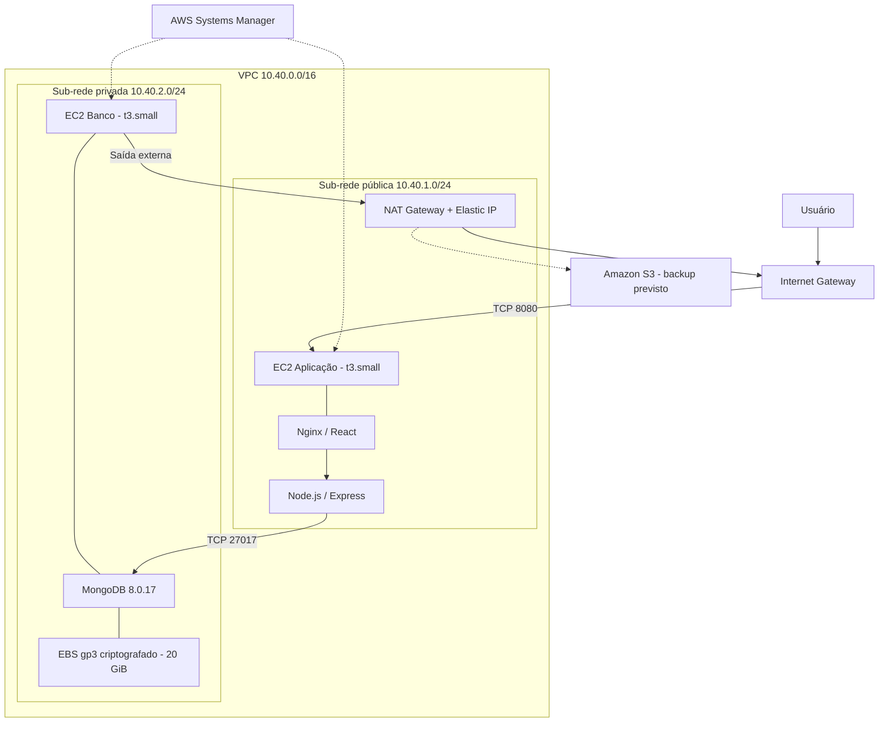
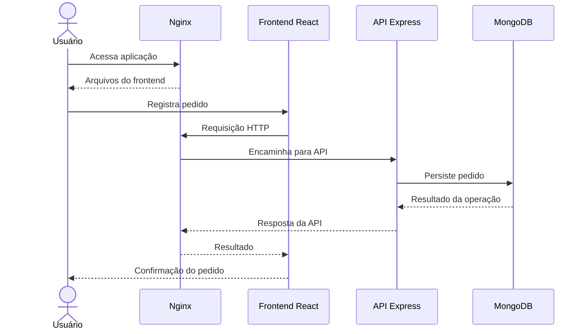
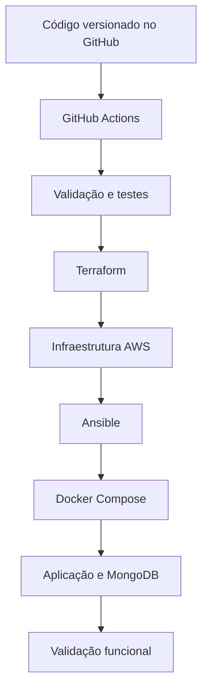

# Tecnologias e Atendimento aos Requisitos

**Projeto:** KubeShop - PM04

**Responsável pela documentação:** João Pedro Foster Ruiz

**Data:** 27/11/2026

## 1. Introdução

O projeto KubeShop consiste em uma aplicação web para
registro e gerenciamento de pedidos, utilizando uma
arquitetura distribuída em infraestrutura de nuvem.

A solução utiliza Amazon Web Services (AWS), com
separação entre a camada de aplicação e a camada
de banco de dados.

A infraestrutura foi definida como código, utilizando
Terraform, enquanto o Ansible é utilizado para
automatizar a configuração dos servidores.

A aplicação utiliza containers Docker, permitindo
padronização dos ambientes e maior previsibilidade
durante a implantação.

A estratégia também contempla automação de deploy,
segurança de rede, persistência de dados e mecanismos
de backup e restauração.

## 2. Objetivos técnicos

A arquitetura possui os seguintes objetivos:

- Separar aplicação e banco de dados.
- Reduzir a exposição pública dos recursos.
- Automatizar o provisionamento da infraestrutura.
- Automatizar a configuração dos servidores.
- Padronizar a execução dos componentes.
- Garantir persistência dos dados.
- Permitir recuperação de backups.
- Facilitar a manutenção e evolução da aplicação.
- Preparar processos automatizados de CI/CD.
- Controlar os custos operacionais da infraestrutura.

## 3. Tecnologias utilizadas

### 3.1. Aplicação

| Tecnologia | Versão | Finalidade |
|---|---|---|
| React | 19.3.1 | Interface web |
| Vite | 8.3.4 | Desenvolvimento e build do frontend |
| Node.js | 24.15.0 | Ambiente de execução JavaScript |
| Express | 5.3 | API backend |
| MongoDB Node.js Driver | 7.7 | Comunicação com o banco |
| MongoDB | 8.0.17 | Persistência dos pedidos |
| Nginx | 1.28.0 | Servidor web e proxy reverso |
| Playwright | 1.64.1 | Testes automatizados da aplicação |

As versões correspondem aos arquivos de configuração
analisados durante a elaboração da documentação.

### 3.2. Infraestrutura e automação

| Tecnologia | Finalidade |
|---|---|
| Amazon Web Services | Plataforma de computação em nuvem |
| Amazon EC2 | Máquinas virtuais |
| Amazon VPC | Isolamento e organização da rede |
| Amazon EBS | Armazenamento persistente |
| Internet Gateway | Comunicação da rede pública com a internet |
| NAT Gateway | Saída para internet da rede privada |
| Security Groups | Controle de tráfego de rede |
| AWS IAM | Identidades e permissões |
| AWS Systems Manager | Gerenciamento remoto |
| Amazon S3 | Destino previsto para backups |
| Terraform | Provisionamento da infraestrutura |
| Ansible | Configuração automatizada dos servidores |
| Docker | Containerização |
| Docker Compose | Organização dos serviços |
| GitHub | Versionamento do código |
| GitHub Actions | Automação de CI/CD |
| Ubuntu 24.04 LTS | Sistema operacional das EC2 |

### 3.3. Backup e validação

| Tecnologia | Finalidade |
|---|---|
| Bash | Automação dos procedimentos |
| Python 3 | Geração e validação do manifesto |
| mongodump | Exportação lógica do MongoDB |
| mongorestore | Recuperação dos dados |
| mongosh | Consultas e validação |
| gzip | Compactação dos arquivos |
| JSON | Metadados do backup |
| SHA-256 | Verificação de integridade |
| AWS CLI | Comunicação com Amazon S3 |
| Docker Desktop | Ambiente de testes locais |
| PowerShell e Git Bash | Execução dos testes no Windows |

## 4. Justificativa das tecnologias

### 4.1. React e Vite

O React permite desenvolver interfaces utilizando
componentes reutilizáveis.

O Vite fornece ferramentas para desenvolvimento,
compilação e geração dos arquivos estáticos do frontend.

A combinação facilita a manutenção da interface e
a distribuição dos arquivos em um servidor web.

### 4.2. Node.js e Express

O Node.js permite executar JavaScript no servidor.

O Express fornece recursos para implementação de APIs,
tratamento de requisições HTTP e organização das rotas.

A utilização de JavaScript no frontend e backend
contribui para a padronização da stack da aplicação.

### 4.3. MongoDB

O MongoDB é um banco de dados orientado a documentos.

Sua estrutura permite representar os pedidos por meio
de documentos BSON, oferecendo flexibilidade para
evolução do modelo de dados.

O banco utilizado pela aplicação é denominado kubeshop,
com os pedidos armazenados na coleção orders.

A aplicação utiliza o driver oficial do MongoDB para
realizar operações de leitura e escrita.

### 4.4. Nginx

O Nginx é utilizado como servidor web e proxy reverso.

Sua função consiste em disponibilizar o frontend e
encaminhar as requisições destinadas à API para o
serviço backend.

Essa organização evita a necessidade de expor
diretamente a porta interna do backend à internet.

### 4.5. Terraform

O Terraform permite definir recursos de infraestrutura
por meio de arquivos declarativos.

A infraestrutura como código oferece benefícios como:

- Versionamento das configurações.
- Revisão de alterações.
- Reprodutibilidade do ambiente.
- Planejamento antes do provisionamento.
- Redução de configurações manuais.
- Maior rastreabilidade das alterações.

Os recursos AWS são definidos no diretório terraform.

### 4.6. Ansible

O Ansible é utilizado para automatizar a configuração
dos servidores após o provisionamento.

Sua utilização permite organizar tarefas de instalação,
configuração e preparação dos serviços.

A idempotência é um objetivo da automação, permitindo
reaplicar configurações sem alterações desnecessárias.

A comprovação da idempotência depende dos resultados
das execuções da automação.

### 4.7. Docker e Docker Compose

O Docker permite empacotar aplicações e dependências
em containers.

O Docker Compose organiza a configuração e execução
dos serviços relacionados.

O projeto utiliza configurações separadas para a
camada de aplicação e a camada de banco de dados.

Essa separação permite executar os componentes em
máquinas virtuais distintas.

### 4.8. GitHub Actions

O GitHub Actions é utilizado como ferramenta de
automação dos processos de integração e entrega.

A estratégia de CI/CD permite organizar etapas de
validação, build, testes, provisionamento, configuração
e implantação.

A rotina de backup foi preparada para integração
futura com workflows automatizados.

A existência de uma configuração de pipeline não
comprova, por si só, a execução bem-sucedida de todas
as suas etapas.

## 5. Arquitetura da infraestrutura AWS

### 5.1. Configuração geral

| Recurso | Configuração definida |
|---|---|
| Região | us-east-1 |
| Zona de disponibilidade | us-east-1a |
| VPC | pm04-kubeshop-vpc |
| CIDR da VPC | 10.40.0.0/16 |
| Sub-rede pública | 10.40.1.0/24 |
| Sub-rede privada | 10.40.2.0/24 |
| EC2 de aplicação | t3.small |
| EC2 de banco de dados | t3.small |
| Sistema operacional | Ubuntu 24.04 LTS |
| Disco raiz da aplicação | 12 GiB |
| Disco raiz do banco | 12 GiB |
| Volume de dados MongoDB | 20 GiB gp3 criptografado |
| Armazenamento total previsto | 44 GiB |
| Porta pública da aplicação | TCP 8080 |
| Porta do MongoDB | TCP 27017 |
| Porta interna do backend | TCP 3000 |

Os valores apresentados correspondem às configurações
e aos valores padrão do Terraform analisado.

Alterações de variáveis durante o provisionamento
podem modificar a configuração efetivamente implantada.

### 5.2. Camada de aplicação

A camada de aplicação é executada em uma instância
EC2 localizada na sub-rede pública.

A instância possui endereço IP público e acesso
à internet por meio do Internet Gateway.

Os componentes da aplicação incluem:

- Frontend React.
- Servidor web Nginx.
- API Node.js com Express.

A comunicação externa ocorre pela porta TCP 8080,
conforme a configuração de rede analisada.

A API utiliza a porta interna TCP 3000.

### 5.3. Camada de banco de dados

O MongoDB é executado em uma instância EC2 localizada
na sub-rede privada.

A instância não possui endereço IP público.

A comunicação com o banco ocorre utilizando o endereço
privado da instância e a porta TCP 27017.

O Security Group do banco restringe o acesso à porta
27017 ao Security Group da aplicação.

Essa configuração reduz a exposição do banco à internet.

### 5.4. Internet Gateway

O Internet Gateway permite a comunicação dos recursos
da sub-rede pública com a internet, desde que possuam
endereçamento e regras de segurança adequados.

A tabela de rotas pública utiliza o Internet Gateway
como destino da rota padrão.

### 5.5. NAT Gateway

O NAT Gateway está localizado na sub-rede pública.

Sua função é permitir que recursos da sub-rede privada
iniciem conexões com destinos externos.

A tabela de rotas privada direciona o tráfego externo
ao NAT Gateway.

Isso permite, por exemplo, obter atualizações de
software e acessar serviços AWS sem atribuir um
endereço IP público à instância do banco.

O NAT Gateway não disponibiliza acesso público
direto ao MongoDB.

### 5.6. Diagrama lógico

O diagrama representa a arquitetura lógica definida
e os componentes previstos para integração.

O Amazon S3 é uma dependência externa ainda pendente
de provisionamento e validação.

## 6. Segurança da infraestrutura

### 6.1. Segmentação de rede

A infraestrutura utiliza uma VPC com sub-redes pública
e privada.

A aplicação permanece acessível externamente, enquanto
o banco de dados é mantido em uma rede privada.

Essa separação reduz a superfície de exposição dos
recursos que armazenam os dados da aplicação.

### 6.2. Security Groups

Os Security Groups controlam o tráfego permitido
para as instâncias EC2.

| Origem | Destino | Porta | Finalidade |
|---|---|---|---|
| Internet | EC2 aplicação | TCP 8080 | Acesso web |
| Security Group da aplicação | EC2 banco | TCP 27017 | Acesso MongoDB |
| Nginx | Backend | TCP 3000 | Comunicação interna |

A porta TCP 3000 corresponde à comunicação interna
da aplicação, não a uma regra pública adicional.

A configuração analisada permite tráfego de saída.
Uma política de egress mais restritiva pode ser
avaliada como melhoria de segurança.

### 6.3. IAM e Systems Manager

As instâncias possuem perfis IAM associados.

A política AmazonSSMManagedInstanceCore fornece
permissões necessárias para a integração básica
com o AWS Systems Manager.

O Systems Manager permite gerenciamento remoto
sem exigir exposição pública da porta SSH.

A disponibilidade efetiva desse gerenciamento depende
do agente SSM, das permissões e da conectividade
com os endpoints necessários.

As permissões de acesso ao S3 para backup devem
ser configuradas separadamente.

### 6.4. Proteção dos metadados das instâncias

A configuração das instâncias utiliza tokens
obrigatórios no serviço de metadados EC2.

Essa configuração exige a utilização do IMDSv2,
contribuindo para reduzir riscos associados ao
acesso indevido aos metadados da instância.

### 6.5. Gerenciamento de credenciais

O MongoDB utiliza autenticação e separação entre
usuário administrativo e usuário da aplicação.

As credenciais são fornecidas por meio de secrets
utilizados pelo Docker Compose.

O usuário da aplicação possui a função readWrite
restrita ao banco kubeshop.

Senhas, tokens e chaves de acesso não devem ser
incluídos diretamente no código versionado.

O acesso futuro ao S3 deverá utilizar IAM Role,
evitando credenciais AWS permanentes nos scripts.

### 6.6. Criptografia

O volume EBS dedicado aos dados do MongoDB possui
criptografia habilitada.

Para o armazenamento de backups no S3, a estratégia
prevê criptografia SSE-S3 com AES-256.

A criptografia dos backups no S3 ainda precisa
ser validada na infraestrutura implantada.

A configuração analisada não comprova a existência
de HTTPS público para a aplicação ou TLS entre
a API e o MongoDB.

Esses mecanismos podem ser avaliados como melhorias
para ambientes de produção.

## 7. Persistência de dados

O MongoDB utiliza um volume EBS dedicado de 20 GiB,
do tipo gp3 e com criptografia habilitada.

O volume é associado à instância de banco de dados.

Os diretórios persistentes são disponibilizados
ao container por meio de bind mounts.

Essa estratégia permite manter os arquivos do banco
fora da camada gravável do container.

A recriação do container não deve eliminar os dados,
desde que o volume e os diretórios persistentes
sejam mantidos corretamente.

A persistência efetiva deve ser validada por testes
de recriação do container e reinicialização da EC2.

A utilização de EBS não substitui backups externos.

## 8. Fluxo de funcionamento da aplicação

1. O usuário acessa a aplicação pela porta 8080.
2. O Nginx disponibiliza os arquivos do frontend.
3. O frontend realiza requisições à API.
4. O Nginx encaminha as requisições ao backend.
5. O backend processa as operações solicitadas.
6. O backend acessa o MongoDB pela rede privada.
7. O MongoDB realiza as operações de persistência.
8. A API retorna o resultado ao frontend.
9. A interface apresenta o resultado ao usuário.

## 9. Infraestrutura como código e automação

A estratégia de implantação utiliza Terraform,
Ansible e Docker Compose.

### 9.1. Terraform

O Terraform é responsável pela definição dos recursos:

- VPC.
- Sub-redes.
- Tabelas de rotas.
- Internet Gateway.
- NAT Gateway.
- Elastic IP do NAT Gateway.
- Security Groups.
- Instâncias EC2.
- Perfis e funções IAM.
- Volume EBS adicional do MongoDB.

O fluxo de provisionamento contempla operações
de inicialização, validação, planejamento e aplicação.

### 9.2. Ansible

O Ansible é responsável pela configuração dos
servidores provisionados.

Sua utilização busca reduzir intervenções manuais
e garantir padronização do ambiente.

A configuração deve considerar as dependências,
os arquivos de ambiente, os secrets, os diretórios
persistentes e os serviços Docker.

### 9.3. Docker Compose

Os serviços são organizados em configurações
separadas para aplicação e banco de dados.

Essa divisão acompanha a separação física das
instâncias EC2.

### 9.4. Fluxo de implantação

O fluxo representa a estratégia de automação do projeto.

Os links e resultados das execuções reais da pipeline
deverão ser registrados nas evidências de implantação.

## 10. Backup e restauração

A rotina de backup foi implementada por meio dos
seguintes scripts:

- `scripts/backup/backup-mongodb.sh`
- `scripts/backup/restore-mongodb.sh`

O script de backup realiza a exportação lógica do
banco kubeshop, compactação, cálculo SHA-256 e
geração de um manifesto JSON.

O script de restauração verifica a integridade
do arquivo e recupera os documentos em um banco
temporário.

A restauração não sobrescreve automaticamente
o banco original.

### 10.1. Política proposta

| Parâmetro | Configuração |
|---|---|
| Frequência | Diária |
| Retenção | 30 dias |
| RPO proposto | 24 horas |
| RTO proposto | 60 minutos |
| Destino previsto | Amazon S3 |
| Criptografia prevista | SSE-S3 |
| Integridade | SHA-256 |

As metas de RPO e RTO ainda precisam ser validadas
em condições reais de operação na AWS.

### 10.2. Resultados dos testes locais

Os scripts foram testados em ambiente local com
Docker Desktop e MongoDB 8.0.17.

| Validação | Resultado |
|---|---|
| Backup automatizado | Aprovado |
| Manifesto JSON | Aprovado |
| Verificação SHA-256 | Aprovado |
| Pedidos exportados | 11 |
| Pedidos restaurados | 11 |
| Pedidos mantidos no banco original | 12 |
| Comparação integral dos documentos | Aprovado |
| Preservação do pedido adicional | Aprovado |

A comparação integral dos documentos foi realizada
como validação complementar utilizando mongosh.

A integração com S3 e a execução na EC2 ainda
dependem de validação.

Documentação detalhada:

[Backup e Restauração do MongoDB](backup-e-restauracao.md)

## 11. Matriz de atendimento aos requisitos técnicos

### 11.1. Classificação

Os requisitos são classificados da seguinte forma:

- Implementado em código: recurso ou configuração
  identificado nos arquivos do projeto.
- Validado localmente: comportamento comprovado
  por testes realizados em ambiente local.
- Parcial: implementação existente com etapas
  adicionais necessárias.
- Pendente: configuração ou evidência ainda necessária.

Os identificadores RT são utilizados exclusivamente
para organização desta documentação e não representam
a numeração oficial de uma rubrica acadêmica.

### 11.2. Infraestrutura

| ID | Requisito técnico | Solução adotada | Status |
|---|---|---|---|
| RT01 | Infraestrutura em nuvem | AWS | Implementado em código |
| RT02 | Duas máquinas virtuais | EC2 aplicação e banco | Implementado em código |
| RT03 | Rede virtual isolada | Amazon VPC | Implementado em código |
| RT04 | Sub-rede pública | Sub-rede da aplicação | Implementado em código |
| RT05 | Sub-rede privada | Sub-rede do MongoDB | Implementado em código |
| RT06 | Acesso externo à aplicação | Internet Gateway e IP público | Implementado em código |
| RT07 | Saída externa da rede privada | NAT Gateway | Implementado em código |
| RT08 | Infraestrutura como código | Terraform | Implementado em código |
| RT09 | Configuração automatizada | Ansible | Implementado em código |

### 11.3. Aplicação e persistência

| ID | Requisito técnico | Solução adotada | Status |
|---|---|---|---|
| RT10 | Interface web | React e Vite | Implementado em código |
| RT11 | API backend | Node.js e Express | Implementado em código |
| RT12 | Banco de dados | MongoDB | Implementado em código |
| RT13 | Proxy reverso | Nginx | Implementado em código |
| RT14 | Containerização | Docker | Implementado em código |
| RT15 | Organização dos serviços | Docker Compose | Implementado em código |
| RT16 | Persistência externa ao container | EBS e bind mounts | Implementado em código |
| RT17 | Funcionamento completo na AWS | Implantação e smoke test | Evidência pendente |

### 11.4. Segurança

| ID | Requisito técnico | Solução adotada | Status |
|---|---|---|---|
| RT18 | Banco sem IP público | EC2 em rede privada | Implementado em código |
| RT19 | Controle de acesso de rede | Security Groups | Implementado em código |
| RT20 | Acesso restrito ao MongoDB | Regra TCP 27017 entre SGs | Implementado em código |
| RT21 | Gerenciamento remoto | AWS Systems Manager | Implementado em código |
| RT22 | Controle de identidade | IAM Roles | Implementado em código |
| RT23 | Proteção de metadados | IMDSv2 | Implementado em código |
| RT24 | Criptografia do volume de dados | EBS criptografado | Implementado em código |
| RT25 | Gerenciamento de senhas | Docker secrets | Implementado em código |
| RT26 | Permissões restritas para backup | IAM para S3 | Pendente |

### 11.5. Backup e recuperação

| ID | Requisito técnico | Solução adotada | Status |
|---|---|---|---|
| RT27 | Rotina de backup | mongodump e Bash | Validado localmente |
| RT28 | Rotina de restauração | mongorestore e Bash | Validado localmente |
| RT29 | Compactação | gzip | Validado localmente |
| RT30 | Manifesto automático | Python e JSON | Validado localmente |
| RT31 | Integridade do backup | SHA-256 | Validado localmente |
| RT32 | Restauração não destrutiva | Banco temporário | Validado localmente |
| RT33 | Validação da quantidade de pedidos | mongosh | Validado localmente |
| RT34 | Preservação de novos pedidos | Teste complementar | Validado localmente |
| RT35 | Backup externo | Amazon S3 | Parcial |
| RT36 | Agendamento automático | GitHub Actions | Pendente |
| RT37 | Política de retenção | S3 Lifecycle | Pendente |
| RT38 | Definição de RPO e RTO | Política documentada | Parcial |

### 11.6. Automação e documentação

| ID | Requisito técnico | Solução adotada | Status |
|---|---|---|---|
| RT39 | Versionamento | Git e GitHub | Implementado |
| RT40 | Integração e entrega contínua | GitHub Actions | Evidência pendente |
| RT41 | Testes automatizados | Playwright e smoke tests | Implementado em código |
| RT42 | Idempotência | Terraform e Ansible | Evidência pendente |
| RT43 | Documentação da arquitetura | Markdown | Elaborado |
| RT44 | Documentação das tecnologias | Markdown | Elaborado |
| RT45 | Documentação de backup | Markdown | Elaborado |
| RT46 | Diagrama da infraestrutura | Mermaid | Elaborado |
| RT47 | Diagrama visual Draw.io | Arquivo de arquitetura | Pendente |
| RT48 | Estimativa de custos | Análise mensal AWS | Pendente |
| RT49 | Evidências de implantação | Capturas e links | Pendente de consolidação |

## 12. Testes e evidências

A validação da solução deve considerar diferentes
camadas da infraestrutura.

| Validação | Evidência esperada |
|---|---|
| Provisionamento | Execução Terraform e recursos AWS |
| Configuração | Execução do Ansible |
| Idempotência | Reexecução sem mudanças desnecessárias |
| Rede pública | Acesso à aplicação |
| Rede privada | Banco sem IP público |
| Comunicação interna | Conexão entre API e MongoDB |
| Persistência | Dados mantidos após recriação |
| Aplicação | Smoke test e testes funcionais |
| Backup | Arquivo e manifesto gerados |
| Restauração | Quantidade de pedidos recuperados |
| Integridade | SHA-256 e comparação de documentos |
| S3 | Objetos armazenados e recuperados |
| CI/CD | Links das execuções da pipeline |

As evidências de backup e restauração local já possuem
resultados registrados na documentação específica.

As evidências da infraestrutura AWS devem ser obtidas
junto à equipe responsável pela implantação.

## 13. Custos da infraestrutura

Os principais componentes que influenciam o custo
mensal da solução são:

- Duas instâncias EC2 t3.small.
- Volumes EBS totalizando 44 GiB.
- NAT Gateway.
- Endereços IPv4 públicos.
- Processamento de dados pelo NAT Gateway.
- Transferência de dados.
- Armazenamento e requisições Amazon S3.

O NAT Gateway possui cobrança associada ao tempo
de funcionamento e ao processamento de dados.

A utilização de instâncias de pequeno porte busca
manter o custo compatível com o ambiente acadêmico.

A estimativa detalhada deverá considerar a região
us-east-1, os preços vigentes e as premissas de uso.

A estimativa não representa uma fatura real da AWS.

## 14. Limitações da arquitetura

A arquitetura analisada possui duas instâncias EC2,
com uma instância dedicada a cada camada.

Os componentes estão definidos em uma única zona
de disponibilidade.

Portanto, a separação entre aplicação e banco não
representa alta disponibilidade ou redundância
automática.

Uma falha da instância de aplicação, da instância
do banco ou da zona pode causar indisponibilidade.

Outras limitações identificadas:

- Ausência de replicação MongoDB na arquitetura analisada.
- Ausência de balanceador de carga identificado.
- Ausência de escalabilidade horizontal automática.
- Dependência de um único NAT Gateway.
- Integração S3 ainda pendente.
- RPO e RTO ainda não medidos na AWS.
- HTTPS público ainda não comprovado.
- Monitoramento e alertas ainda não comprovados.
- Recuperação integral da aplicação ainda não testada.

Essas limitações não invalidam os testes realizados,
mas delimitam o nível de disponibilidade e segurança
que pode ser comprovado.

## 15. Melhorias futuras

Como possibilidades de evolução da arquitetura:

- Configurar HTTPS para acesso público.
- Utilizar domínio próprio.
- Implementar monitoramento e alertas.
- Automatizar backups periódicos.
- Configurar retenção automática no Amazon S3.
- Realizar testes periódicos de recuperação.
- Implementar VPC Endpoint para Amazon S3.
- Avaliar permissões de rede mais restritivas.
- Implementar redundância em múltiplas zonas.
- Avaliar replicação do MongoDB.
- Avaliar balanceamento de carga e escalabilidade.
- Medir custos reais e otimizar os recursos.

Essas melhorias devem ser avaliadas conforme os
requisitos, riscos e orçamento do projeto.

## 16. Documentação relacionada

- [Arquitetura da infraestrutura](arquitetura.md)
- [Backup e restauração](backup-e-restauracao.md)
- [Diagrama Mermaid](assets/diagrama-infraestrutura.mmd)

A documentação de custos e o diagrama Draw.io
serão incorporados após sua elaboração.

## 17. Conclusão

O projeto KubeShop utiliza uma arquitetura baseada
em AWS, infraestrutura como código, configuração
automatizada e execução de serviços em containers.

A separação entre aplicação e banco de dados
contribui para organização, isolamento e segurança.

O Terraform define os recursos necessários para
a infraestrutura, enquanto o Ansible e o Docker
Compose compõem a estratégia de configuração e
implantação dos serviços.

A rotina de backup e restauração foi validada
funcionalmente em ambiente local, demonstrando
a recuperação dos documentos esperados sem
sobrescrever o banco original.

A consolidação das evidências de implantação,
a integração com Amazon S3 e a validação da
pipeline são etapas necessárias para comprovar
o funcionamento completo da solução na AWS.
